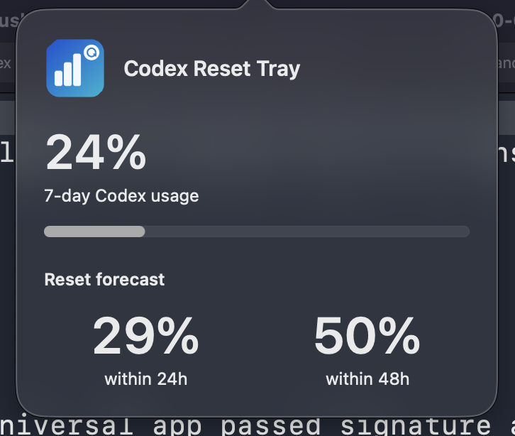

# Codex Reset Tray

[](https://github.com/sklivvz/codex-reset-tray/actions/workflows/ci.yml)
[](https://github.com/sklivvz/codex-reset-tray/releases)
[](LICENSE)

A small macOS menu-bar app that watches **your own Codex quota** through the
local `codex app-server` and notifies you when the 7-day usage window resets,
whether that happens at its scheduled deadline or early. It also shows
[codexreset.org](https://codexreset.org/) forecasts in the left-click
information popover, but those forecasts are informational and never trigger
notifications.





## Download for macOS

[**Download Codex Reset Tray v0.2.0 — Universal (Apple Silicon + Intel)**](https://github.com/sklivvz/codex-reset-tray/releases/download/v0.2.0/CodexResetTray-v0.2.0-macos-universal.dmg)

- Direct DMG: [`CodexResetTray-v0.2.0-macos-universal.dmg`](https://github.com/sklivvz/codex-reset-tray/releases/download/v0.2.0/CodexResetTray-v0.2.0-macos-universal.dmg)
- SHA-256: [`CodexResetTray-v0.2.0-macos-universal.dmg.sha256`](https://github.com/sklivvz/codex-reset-tray/releases/download/v0.2.0/CodexResetTray-v0.2.0-macos-universal.dmg.sha256)
- All releases: <https://github.com/sklivvz/codex-reset-tray/releases>

The DMG contains `CodexResetTray.app`, an `Applications` shortcut for
drag-to-install, a short README, `LICENSE`, and `NOTICE`.

### Install

1. Open the DMG.
2. Drag **Codex Reset Tray** onto the **Applications** shortcut.
3. Launch it from Applications.

This is an independent, ad-hoc-signed build, not a notarized Developer ID build.
On first launch macOS may require right-click **Open**, or **System Settings >
Privacy & Security > Open Anyway**. The source is public and the bundle
signature/contents are checked by the packaging script; see
[Build, test, and package](#build-test-and-package).

To verify the download:

```sh
shasum -a 256 -c CodexResetTray-v0.2.0-macos-universal.dmg.sha256
```

## Two surfaces: information and actions

The menu-bar item always shows a monochrome template glyph derived from the
packaged `AppIcon.icns` (the packaged app icon remains colored). By default it
also shows the current 7-day usage text, for example `7d 89%`, a compact 4 pt to
the right of the icon.

There are exactly two surfaces:

- **Left click** opens one compact, anchored, transient `NSPopover` below the
  menu-bar item. It keeps the 7-day usage headline and meter, plus two large
  side-by-side forecast figures for the next 24 and 48 hours. Loading, stale,
  and error states use normal label or readable error text, never disabled gray.
  Codex windows, baseline, notification prose, the latest confirmed reset,
  check times, version/build, and the old footer are intentionally absent; the
  popover updates while open and closes transiently when you click elsewhere.
- **Right click** (or control-click) first dismisses the open information
  popover, then opens one native `NSMenu` containing only configuration and
  actions: the 7d label toggle, **Enable Notifications** with a native check
  mark, Refresh, Copy Status Summary, Open codexreset.org, Support this project,
  a native separator, **About Codex Reset Tray**, and Quit. The menu has no
  heading and no informational rows.

Native gray text means an action is genuinely disabled. The actions menu never
uses gray for status or to de-emphasize information, because it contains none.

- **Show 7d Label** is always the first action's exact title, and it is checked
  by default while the `7d 89%` text is visible.
- Selecting a checked item hides the text and clears the check mark, leaving
  only the icon; selecting it again restores the text and the check mark. The
  title does not change; the native check mark alone reflects visibility.
- The choice persists in `UserDefaults` under the key
  `codexShowUsageInMenuBar` and is restored on the next launch.
- The icon itself is never hidden by this setting, including in error states.

The offscreen AppKit tests exercise both label states, the native check mark,
the retained icon, persistence across store restarts, the exact compact popover
content, large forecast-figure typography and side-by-side layout, and the
absence of the removed usage-section, footer, version, and notification text.
They also assert that the menu model contains no informational rows. The
offscreen suite does not exercise the real menu-bar item or observe the screen;
the opt-in live check below covers those paths.

- **Enable Notifications** is a checked menu action, not popover prose. It is
  checked only when macOS reports `authorized`, `provisional`, or `ephemeral`.
  When authorization is still `notDetermined`, selecting it calls
  `requestAuthorization` so macOS shows its prompt. Once permission is denied,
  Apple does not allow the app to prompt again, so selecting the item opens
  **System Settings > Notifications** instead. When permission is already
  allowed, selecting it also opens that pane so the checked item remains
  meaningful. The authorization is re-read when the menu opens and when the app
  regains focus, so the check mark follows changes made in System Settings.
- **About Codex Reset Tray** opens AppKit's standard About panel with the app
  icon and the bundle's version and build. The presenter is injectable, so tests
  verify the action and panel configuration without displaying a panel.

### Codex usage: source of truth

- Immediately after launch and then every 5 minutes, the app starts a local
  `codex app-server --listen stdio://`, performs the JSON-RPC `initialize`
  handshake, and calls `account/rateLimits/read`. It only reads usage; it does
  not log in, log out, or modify account state.
- Each call has a hard 10-second deadline. A missing binary, launch failure, RPC
  error, timeout, or malformed response is reflected by the error menu-bar glyph
  and accessibility description, and remains available in Copy Status Summary;
  it can never produce a notification.
- The 7-day window is identified by `windowDurationMins == 10080`, whichever
  slot (`primary` or `secondary`) contains it. This matters because Codex has
  returned the weekly window as `primary` on some accounts. The window's
  `resetsAt` is used as the prior reset deadline.

### Reset notification

The app persists the latest 7-day usage baseline in `UserDefaults` under
`codexWeeklyUsageBaselineV2`: prior used percentage, prior `resetsAt`, capture
time, and an "already notified" marker for that reset deadline. A notification is
considered only when **all** of these are true:

1. This launch has already established a session baseline. The first successful
   reading after launch only adopts current state and never alerts, even when a
   persisted baseline exists, because that state may describe a reset that
   happened while the app was closed.
2. No notification has already been scheduled for that prior reset deadline.
3. Codex reports a genuine reset signal: either the new 7-day `resetsAt` is at
   least 5 minutes later than the prior deadline (a new window, whether scheduled
   or early), or, when prior usage was greater than 0%, current usage is at most
   25% and has fallen materially (at least 3 percentage points and at least half
   of the prior usage, or cleared to 1% or less from at least 2 points). A
   confirmed new window alerts even from a 0% baseline; the prior-usage
   requirement applies only to same-deadline usage-drop inference. The usage
   ceiling is deliberately above 1%: usage can be consumed again before the next
   poll after a reset. A deadline advancing is sufficient even when usage has
   already climbed in the new window.

A window change at or within 5 minutes before the prior deadline is reported as
the normal **scheduled** reset. A new window or a usage restoration before that
deadline is reported as an **early** reset. Merely reaching the old deadline with
no new deadline and no usage drop does not alert.

`ordinaryUsageAllowed` is reported in the notification, but it is not required
as evidence that the quota itself was restored. A false or missing value does not
suppress a genuine deadline or usage transition.

The notification is requested at most once per reset window. The persisted marker
is written only after the notification scheduler accepts the request. If
authorization is denied or scheduling fails, the prior baseline is retained so a
later poll can retry, and Copy Status Summary keeps the permission/scheduling
state with the sanitized system error domain and code. The alert is not sent on
startup historical state, on a parse or transport failure, or because a
codexreset.org forecast changed.

*Scheduled* means macOS accepted a local notification request. It does not prove
that a banner was visually delivered; notification settings and Focus control
that. A foreground presentation delegate keeps the request visible while the
accessory app is active. The app never prompts for notification permission after
a Codex fetch or while scheduling a reset. The only prompt path is the explicit
**Enable Notifications** menu action while authorization is still
`notDetermined`; scheduling merely reads the current authorization. Permission
status is shown in the menu by the native check mark, and Copy Status Summary
retains the diagnostic detail.

The compact left-click popover deliberately shows only the usage headline/meter
and the two forecast figures (plus a loading, stale, or error line when needed).
It contains no Codex usage section, latest-confirmed-reset row, notification
prose, footer, or version/build text. The right-click menu never duplicates
status data: it always contains only the 7d label toggle, Enable Notifications,
Refresh, Copy Status Summary, Open codexreset.org, Support this project,
About Codex Reset Tray, and Quit. Every action is enabled, and Quit is last.

### codexreset.org forecast

- Forecasts are fetched when the information popover or actions menu opens, or
  when Refresh is pressed.
- Refresh also re-polls Codex usage immediately.
- The compact popover shows 24-hour and 48-hour probabilities as two large,
  side-by-side figures; account-level restoration and the forecast summary remain
  in its tooltip.
- If the site only confirms a reset on its global timeline, the tooltip labels
  that as global and does not claim the monitored account was restored.
- A failed refresh keeps the last two probabilities visible as stale and shows a
  readable error-colored freshness line. A failure with no cached forecast keeps
  the two placeholder columns and shows the error. Opening either surface retries
  after a failure.
- The site is never consulted for notification decisions.

## Requirements

- macOS 13 or later
- Apple Command Line Tools with Swift (no Xcode project required)
- The `codex` CLI installed and signed in with ChatGPT auth
- A Codex app-server that supports the v2 `account/rateLimits/read` method

The app looks for `codex` in common install locations and on `PATH` (including
Homebrew paths, since Finder-launched apps get a minimal environment). Set
`CODEX_BINARY=/absolute/path/to/codex` to override discovery.

## Donations

**Support this project** in the tray menu opens
[PayPal.Me/sklivvz](https://paypal.me/sklivvz) in the default browser. The
recipient page identifies Marco Cecconi and accepts an amount entered by the
supporter. The app handles no payment information. The repository's Sponsor
button uses the same PayPal.Me destination.

## Build, test, and package

```sh
./build.sh
./test.sh
./scripts/package-release.sh
```

- `build.sh` compiles the AppKit app and creates an ad-hoc-signed bundle at
  `build/CodexResetTray.app`. Set `BUILD_ARCHS="arm64 x86_64"` for a universal
  binary; `package-release.sh` does this by default. `build.sh` does not install
  or launch the app.
- `test.sh` runs the Codex JSON/transition tests on fixtures, the pure
  actions-menu and information-popover model tests, an offscreen AppKit
  integration test, the parser smoke test on the checked-in fixture, and the
  bundle/icon/signature checks. Run `./build.sh` before `./test.sh` because the
  bundle test inspects the built app.
- `scripts/package-release.sh` builds the universal app, creates
  `dist/CodexResetTray-v<version>-macos-universal.dmg` containing the app,
  `Applications` shortcut, README, `LICENSE`, and `NOTICE`, writes a
  `.sha256` file, and validates the DMG. Validation verifies the image, attaches
  it **read-only**, checks the bundle identifier/version/icon, verifies the
  app's code signature, confirms both `arm64` and `x86_64`, rejects writes to the
  mounted image, and detaches it.

`Tests/TrayMenuRuntimeTests.swift` compiles the production `TrayMenuController`
with an injected menu source, an unmounted status-button host, a fake URL
opener, and a fake termination handler. It exercises real `NSMenu` and
`NSMenuItem` instances and checks:

- the menu is nonempty before and on the first open and contains exactly the eight
  configuration/actions rows plus the native separator before About/Quit;
- no informational status, usage, reset, notification, or forecast row appears
  in the menu model or in any native `NSMenuItem` title;
- every action is enabled and uses a plain native title, so gray can only ever
  mean a genuinely disabled action;
- the status button uses a monochrome template mask derived from the white
  chart and reset mark in `Resources/AppIcon.icns`, with the SF Symbol only as a
  fallback; the packaged app icon remains colored;
- the icon-label gap is 4 pt, measured from a laid-out button, and disappears
  with the label when it is hidden;
- left clicks through the button action open the information popover, and
  right/control-click mouse-downs through the event handler dismiss any open
  popover before opening the actions menu; the popover is an injected fake that
  records the real status-button anchor, and its content `NSView` is rendered
  offscreen;
- the production popover presenter is configured as `.transient` and hosts the
  same content view without creating a window before it is shown;
- the popover follows source updates while open; a transient close during the
  status-button click still completes the show/hide toggle;
- the popover renders exactly the compact content: usage headline and meter plus
  two large, equal-width, side-by-side 24h/48h percentage figures, with no Codex
  usage section, latest-confirmed-reset row, footer, version/build text, or
  notification-denial prose. Loading, stale, and error lines use label or error
  color rather than disabled gray, and error text meets WCAG AA contrast in
  light and dark;
- Copy Status Summary keeps the full diagnostic usage-window, baseline, reset,
  notification, forecast, and check-time report even though the popover is
  compact;
- the **Show 7d Label** toggle in both states, with its exact title unchanged
  and the native check mark following usage-label visibility, while the icon
  still renders when the text is hidden;
- the `codexShowUsageInMenuBar` preference persists through a store restart and
  defaults to visible;
- the **Enable Notifications** check mark is on only for allowed statuses;
  undetermined clicks request authorization, denied and allowed clicks open the
  Notifications settings URL, the check mark refreshes on menu open and app
  focus, and no Codex fetch or scheduled reset prompts for permission;
- Refresh, Copy Status Summary, Open codexreset.org, Support this project,
  About Codex Reset Tray, and Quit wiring, including the injected About
  presenter and its bundle icon/version/build configuration;
- updates while the menu is open edit existing items rather than replacing them;
- normal scheduled and early resets through `ResetStore`, including the
  per-window duplicate marker, with a deterministic fake notification scheduler;
- foreground presentation delegate registration, explicit authorization
  requests, scheduling without prompts, and sanitized `NSError` domain/code
  diagnostics with a fake notification center.

`./test.sh` also compiles the opt-in live check at
`./.build/tray-menu-runtime-tests`. To run that check on a Mac with an active
GUI session, run `./.build/tray-menu-runtime-tests --live-status-item`. It
briefly creates a real `NSStatusItem` and sends synthetic mouse events through
a running `NSApplication`. It checks that left click shows a transient
information popover anchored to the real status button, renders exactly the
compact usage/forecast content with large side-by-side figures and none of the
removed text, follows a live update, and toggles closed on a second left click.
It then right-clicks while that popover is open, asserting the popover is closed
by the time the native actions menu opens, and separately sends a control-left
click through `NSApplication` to prove that route opens the same actions-only
menu without a popover. The menu is checked for exactly the eight
configuration/actions rows, the notification/About items, no informational
titles, and all actions enabled. It also verifies transient outside-click
dismissal, runs under a bounded watchdog, and removes the status item when done.
This check is opt-in locally because it touches the menu bar and briefly displays
a popover.

CI runs this live harness on a GitHub-hosted `macos-15` runner after
`./build.sh` and `./test.sh`; the step fails the job on any non-zero harness
exit, including a watchdog timeout. This gives the two-surface behavior a real
AppKit event-loop check without requiring a developer desktop session.

The offscreen harness creates an `NSApplication` object only so `NSMenu` can
dispatch item actions. It never calls `run` or `finishLaunching`, never displays
an `NSStatusItem` or popover, activates the app, shows a window, clicks anything
on screen, or launches the app bundle. It also does not use screenshots,
Accessibility UI inspection, AppleScript, `CGWindowList`, or the `open` command.

**The default suite is not a GUI test.** Actual menu-bar rendering/positioning,
real user click/tracking behavior, opening a browser, and process termination
through `NSApplication` are not proven there. The opt-in live check covers the
real status button, popover show/hide/anchor, right-click popover dismissal
before the actions menu, and control-left menu opening with synthetic events,
but it is not a substitute for desktop interaction testing.

`Tests/BundleTests.sh` decodes every representation of both `AppIcon.icns` files
and every iconutil-extracted size to prove each contains nontransparent pixels.
It also validates the bundle's `Info.plist` identifiers, name, package type,
versions, minimum macOS, `LSUIElement`, icon declaration, copied icon, bundled
`LICENSE`/`NOTICE`, and code signature.

The menu bar icon asset is generated from the checked-in drawing script:

```sh
./Tools/generate-app-icon.swift Resources/AppIcon.icns
```

## Privacy and protocol

Only `initialize`, `initialized`, and `account/rateLimits/read` are sent. The
response's `accountId` is ignored and is not stored, displayed, or logged.
Verification output shows only the limit windows and `ordinaryUsageAllowed`
boolean.

The parser follows the Codex app-server v2 types (`RateLimitSnapshot`,
`RateLimitWindow`, and `GetAccountRateLimitsResponse`).

No analytics, accounts, tokens, captured site HTML, or local usage data are
included in this repository or in the app bundle. `.scratch/`, `build/`,
`.build/`, `dist/`, credentials, and local usage data are ignored by Git.

## Notes

This is an unofficial client. codexreset.org is a public HTML source whose page
format can change; the forecast parser can require an update. Early restoration
detection still depends on Codex's own reported usage and backend permission,
not on site predictions or social posts.

## Contributing, security, and license

- [Contributing](CONTRIBUTING.md)
- [Code of Conduct](CODE_OF_CONDUCT.md)
- [Security policy](SECURITY.md)
- [Changelog](CHANGELOG.md)
- Licensed under the [MIT License](LICENSE). Attribution and trademark notes are
  in [NOTICE](NOTICE).

Codex, OpenAI, and related names and marks are trademarks of their respective
owners. This project is independent and is not affiliated with, endorsed by, or
sponsored by OpenAI.
